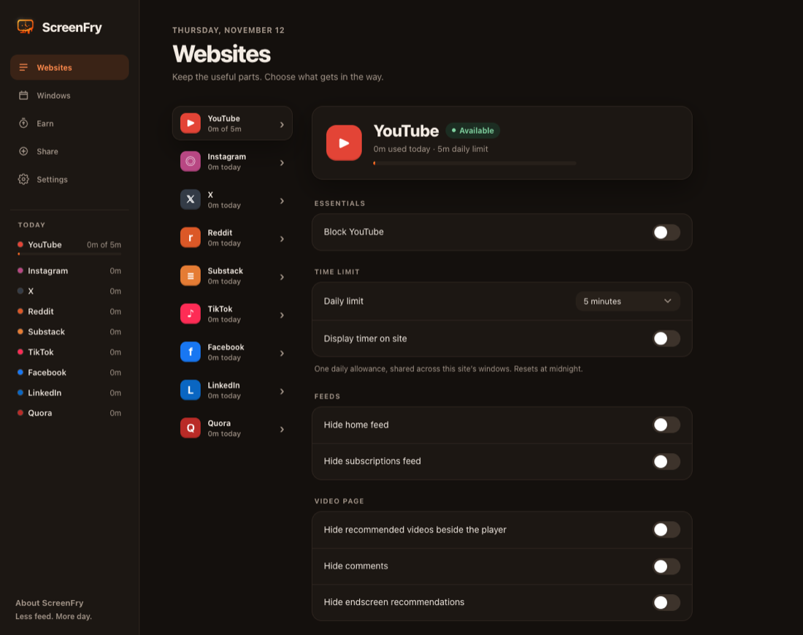

# ScreenFry


**Less feed. More day.** ScreenFry strips the endless feeds, Shorts and recommendations out of social websites and limits how long you spend on them, while search, links, profiles and messages keep working. It runs in **Safari** and **Chrome** on your Mac, with a small menu bar app that sets both up and keeps them updated.

**[Download ScreenFry for Mac](https://github.com/yasserjaghoori/ScreenFry/releases/latest)** · macOS 13 or later · signed and notarized by Apple · [What's new](CHANGELOG.md)



## What it does

| | |
| --- | --- |
| **Hide distractions** | Turn off feeds, recommendations, comments and navigation buttons, website by website. Search, direct links, profiles and messages keep working. |
| **Block Shorts and Reels** | Blocks playback itself, not just the button: links, notifications and in-page players are caught too. Or use **research mode**: a Short opened from a link plays, and nothing after it. |
| **Daily limits** | Give each website its own daily allowance. When it runs out, the whole website is blocked, including tabs already open, until midnight. |
| **Windows** | Schedule when websites are allowed, when they're blocked, and when their feeds open up for a while (**Fry Time**). |
| **Earn** | Earn your time: spend minutes on a website you want to use more (say, a language app) to unlock others or earn Fry Time. |
| **Share** | Keep five setups as **loadouts**, and share one as a short code a friend can paste. |
| **Optional password** | Protect your settings from impulsive changes. It never grants extra time. |
| **Private** | Everything stays on your Mac. No account, server or analytics, and no record of the websites you visit. |

Every control starts **off**: a fresh install changes nothing until you choose.

## Supported websites

| Website | Controls |
| --- | --- |
| **YouTube** | Home and subscriptions feeds · recommended videos beside the player, comments and end screens · **Shorts** (allowed, from links only, or blocked) · Explore, Subscriptions and Notifications buttons · thumbnails and banner ads |
| **Instagram** | Home feed and Stories · Explore feed · **Reels** · Home, Search, Explore, Reels, Messages, Notifications and Create buttons · suggested accounts |
| **X** | For You and Following feeds (separately) · Create Post box · trends and news, Who to follow and Premium promotions · Home, Explore, Notifications, Messages and Grok buttons · video playback · **the video feed** (the full-screen viewer you can scroll through endlessly) |
| **Reddit** | Home, Popular/All and subreddit feeds (separately) · recommended posts and Recent Posts · left sidebar, Chat, Notifications and Create Post buttons · comments and voting · video playback |
| **Substack** | Home and Notes feeds · Home, Subscriptions, Explore, Activity and Chat buttons · video playback |
| **TikTok** | For You, Following and Explore feeds · **research mode** (only the linked video: no scrolling on, no creator profiles) · comments · “You may like” and suggested accounts · For You, Explore, Following, LIVE, Messages, Activity and Upload buttons |
| **Facebook** | Home feed and Stories · sponsored and contacts sidebar · Video feed · **Reels** · Reels, Groups, Marketplace, Gaming and Notifications buttons. Messenger stays separate. |
| **LinkedIn** | Home feed · LinkedIn News and Today’s puzzles · Notifications and Messaging buttons · video playback |
| **Quora** | Home and Following feeds · related questions · ads and promoted answers · Spaces sidebar · Following, Answer, Spaces and Notifications buttons · video playback |

**Shorts, Reels and video feeds** are one choice per website:
- **Allowed**.
- **From links only** (research mode): one opened from a link plays. Going past it, to the next one, the creator's page or anywhere else on the website, shows a short "taking you home" screen and opens the website's home page.
- **Blocked**: none play, even from a link.

Click ScreenFry in the toolbar to change the website you're on; changes apply right away. When a website's time is up, it shows a "Time is up!" screen with a live countdown to when it's back.

## How time is counted

- A website's time counts while it's the **active tab** in the focused window, and while its **audio or video plays** in the background, even muted.
- A background tab that isn't playing doesn't count.
- Several tabs of the same website count once, not once each.
- Time is only measured on websites you've set a rule for, and resets at midnight.
- Safari and Chrome keep their own settings and their own time.

## Windows

The **Windows** page holds three kinds of schedule. Each has a name, days, a start and end time (overnight works) and a list of websites.

- **Allow window:** the websites work *only* during the window, and are blocked outside every allow window, even with time left.
- **Block window:** the websites are blocked *during* the window and work normally otherwise.
- **Fry Time window:** feed blocking pauses during the window for a set number of minutes per website: the same for every website, or custom for each. When a website's minutes run out, its usual settings come back for the rest of the window. Fry Time never unblocks a blocked website or lifts a daily limit.

A block window that overlaps an allow or Fry Time window on the same website still saves, but both pause, clearly marked, until you edit one of them.

*Example:* YouTube has a 10-minute limit and allow windows at 12–1 pm and 6–8 pm. That's 10 minutes for the day, usable in either window, and YouTube is blocked at 3 pm even if none of it was used.

*Example (one browser for research and fun):* hide YouTube's home feed and Shorts all day, then add a Fry Time window from 7–9 pm with 30 minutes. Search and links work all day; in the evening the feed and Shorts open up for 30 minutes.

## Earn

Pick a goal website and how many minutes to spend there, then what meeting the goal does:

- **Unlock websites:** the websites you choose stay blocked each day until the goal is met.
- **Earn Fry Time:** each time the goal is met, feed blocking pauses on the websites you choose for some minutes: the same every time, or more each time (say 1, then 5, then 10). A goal can pay out once, several times or without limit each day.

Only active time counts: the goal website's tab in front while you're using the Mac. **Strict mode** counts only unbroken time, so leaving the goal website starts the count over. A live clock shows your progress on the website, in the toolbar popup and on the Earn page, and a notice appears the moment you earn something.

## Share and loadouts

Keep up to five setups (websites, limits, windows, earn goals and feed blocking) as **loadouts** and switch between them. **Copy share code** turns one into a short line of text (no usage, history or password) to send to a friend. Pasting a code shows what it changes, one slide per website, before you apply it.

The Mac app keeps five loadouts of its own, each holding every browser's setup at once:
- **Save ScreenFry Setup** saves every browser's setup together.
- **Use in All Browsers** gives each browser its own setup back.
- Codes move a setup from Safari to Chrome or back.

## The Mac app

ScreenFry's app lives in the menu bar and starts at login.

- **Setup:** it walks you through turning on ScreenFry in Safari and Chrome, and shows whether each is connected.
- **Updates:** with **Install updates automatically** on (in the window and the menu), new versions install in the background, waiting while its window is open. Otherwise the menu bar icon turns orange and **Update to …** shows what's new. Both browsers update along with the app and keep their settings.
- **Restart Chrome:** when Chrome needs a restart to finish an update, a **Restart Chrome** button appears.

## Install

1. [Download](https://github.com/yasserjaghoori/ScreenFry/releases/latest) `ScreenFry-<version>.dmg`, open it and drag **ScreenFry** onto **Applications**.
2. Open ScreenFry from Applications.
3. Follow its two cards:
   - **Safari:** turn ScreenFry on in Safari's settings, then allow it on websites.
   - **Chrome:** turn on Developer mode on Chrome's Extensions page, then drag the ScreenFry tile onto it.

**Uninstalling:** choose **ScreenFry → Uninstall…** (also at the bottom of the window).
- **Keep Settings** removes the app, while Safari and Chrome keep ScreenFry's settings for a reinstall.
- **Erase Everything** first clears ScreenFry's settings, windows, usage and password in both browsers, then removes every file.

Details are in [Distribution](docs/DISTRIBUTION.md).

## Privacy

ScreenFry has no account, server or analytics. Settings and usage stay in each browser on your Mac. The only network request is the Mac app's hourly update check to GitHub. Full details are in [Privacy](docs/PRIVACY.md).

## Limitations

- Websites change their layouts, which can break individual controls until ScreenFry is updated.
- A regular video link with nothing marking it as a Short can't always be recognized as one.
- The password protects settings inside ScreenFry. It can't stop someone from turning the extension off or removing it.
- Safari and Chrome don't share settings, time or passwords (share codes can copy a setup across).

More in [Enforcement limits](docs/THREAT_MODEL.md).

## Development

You'll need [Node.js](https://nodejs.org) (the version in `.nvmrc`). Building the Mac app also needs Xcode and [XcodeGen](https://github.com/yonaskolb/XcodeGen).

```bash
npm ci
npm run check       # unit tests, type check and a verified Chrome build
npm run test:e2e    # Chrome integration tests in a throwaway profile
npm run dmg:local   # the Mac app and installer, signed with your Apple Development identity
```

To try the Chrome extension alone, run `npm run build`, open `chrome://extensions`, turn on **Developer mode** and **Load unpacked** the `dist/chrome` folder. Safari needs the Mac app: see [Safari](docs/SAFARI.md). Run builds and integration tests one at a time, since both use `dist/chrome`.

| Folder | What's in it |
| --- | --- |
| `apps/extension` | Dashboard, popup, blocked page, background and content scripts |
| `packages/feed-blockers` | **The site registry:** every website's domains and controls ([Adding a website](docs/ADDING_A_SITE.md)) |
| `packages/policy-engine` | Decides whether a page is allowed right now |
| `packages/core` | Settings, password checks, time tracking and data migration |
| `packages/browser-adapters` | Messaging, storage and Chrome/Safari differences |
| `safari/ScreenFry` | The Mac app, which carries the Safari extension and installs the Chrome one |

## Credits

The interface is inspired by [SocialFocus](https://socialfocus.app); none of its code or artwork is used. Some feed selectors are adapted from [Saner Social Media](https://github.com/tobiasdalhof/sanersocialmedia) under the MIT license, whose full notice ships with both builds.

**Docs:** [Architecture](docs/ARCHITECTURE.md) · [Development setup](docs/SETUP.md) · [Testing](docs/TESTING.md) · [Safari](docs/SAFARI.md) · [Distribution](docs/DISTRIBUTION.md) · [Adding a website](docs/ADDING_A_SITE.md) · [Privacy](docs/PRIVACY.md) · [Project brief](docs/PROJECT_BRIEF.md) · [Branding](assets/branding/README.md) · [AI handoff](docs/AI_HANDOFF.md)
